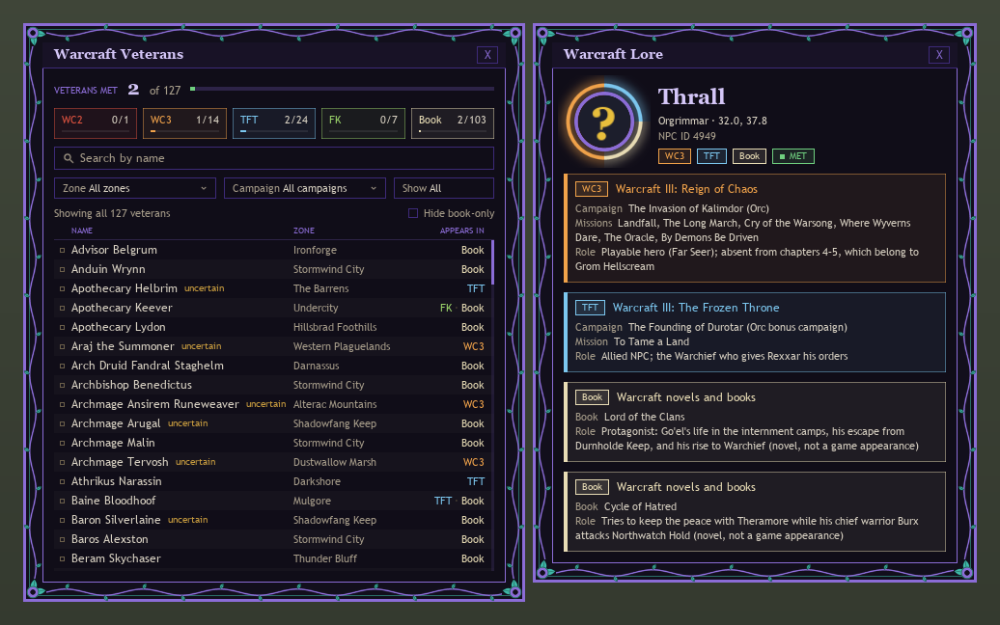
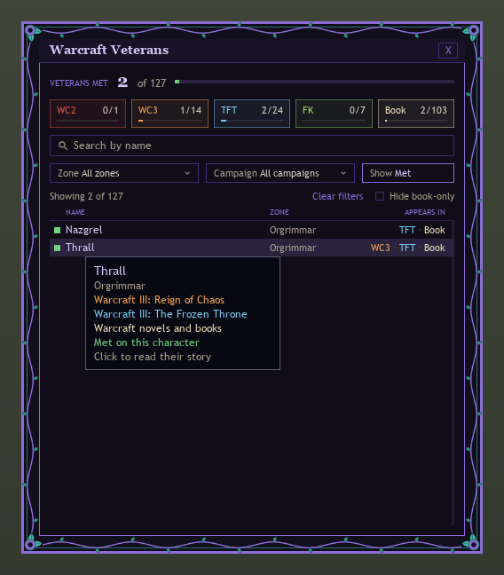
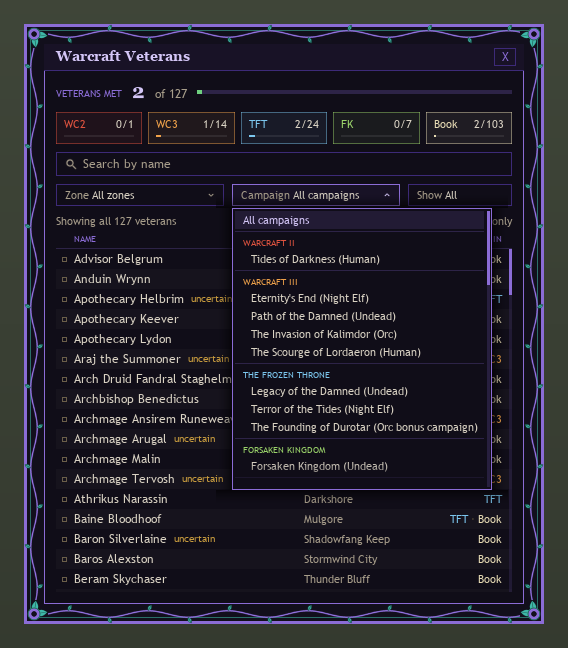
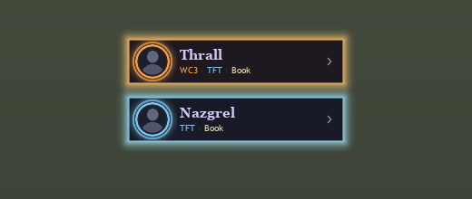
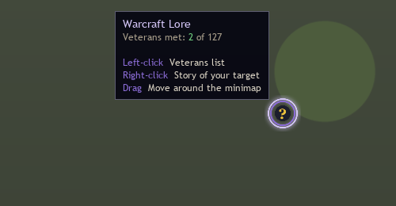

# Warcraft Lore – an addon for World of Warcraft: Forever

Ever run into a random level-15 quest giver and later found out they were in a Warcraft II mission? This addon tells you. It flags NPCs who also appear in the real-time strategy games:

- Warcraft: Orcs & Humans
- Warcraft II: Tides of Darkness and Beyond the Dark Portal
- Warcraft III: Reign of Chaos and The Frozen Throne
- Warcraft III Reforged: Forsaken Kingdom
- Warcraft novels and books (labelled "Book", never presented as a game appearance)

What you get:

- **Tooltip line:** NPCs in the database get one extra line, e.g. "Warcraft Veteran: WC3 · TFT", with each game in its own color. Other NPCs get no line, so ordinary tooltips stay clean.
- **Lore window:** `/wcl` (or clicking the alert pill, a row in the list, or the minimap button's right-click) opens a small window with a live 3D model of the NPC inside a round ring that glows in the game's color (the classic portrait if the model can't load). The story comes first, followed by "Through the ages": every game appearance in release order with its year and role, and the books as compact one-line rows. You also get related veterans (click a name to follow the thread), related WoW items with item IDs, and sources. You can drag the window, close it with X or Esc, and it remembers where you put it.
- **Veterans list and met counter:** `/wcl list` (or a left-click on the minimap button) opens a browse window with every veteran in the database. The addon remembers, for your whole account, which veterans you have met (targeted or moused over), so a veteran met on one character counts on all of them. It shows "Veterans met 13 of 146" with a progress bar and a chip per game ("WC3 3/15"), and prints a chat line the first time you meet one. Search by name or zone, filter by game, zone, campaign or met status, and tick "Hide book-only" to leave out NPCs who only appear in novels. Hover a row for the full name, zone and games; click it to open the lore window next to the list. Hover a met veteran to see how often you met them, and when and with which character you met them first. The lore window shows a green MET badge for veterans you have met.
- **Small glowing alert:** when you target a veteran, or one is close by (nameplate or map position), a small pill with a portrait, the name and the game codes pulses at the top of the screen. Nearby alerts also print one chat line and play a sound. In busy cities the first veteran is announced right away and anyone else nearby is named in one follow-up line ("Also nearby: ..."); click "+N more" to open the Veterans list. Click the pill for the story, right-click to dismiss, shift-drag to move.
- **World map pins:** small round pins show where veterans stand on the map of the zone you are looking at, colored by their first game and green once you have met them. Hover a pin for the name and status, left-click it for the story. Turn them off in the settings ("Show veterans on the world map").
- **Zone atlas:** the zone picker in the Veterans list shows how many veterans you have met in each zone. "This zone" jumps to the zone you are standing in, and a line under the filters says "N of M met here".
- **Export and import:** `/wcl export` shows your met list as a short text you can copy; `/wcl import` merges such a text into this account (earliest first meeting and higher count win, nothing is deleted).
- **Minimap button:** left-click opens the Veterans list, right-click opens the story of your target, drag moves it around the minimap. Hover it to see your met count.
- **Settings page:** find Warcraft Lore in the game's AddOns settings, or type `/wcl options`.
- **`/wcl why`:** explains in plain words why your target is or isn't recognised.

All lore ships inside the addon (addons cannot reach the internet in game), in `WarcraftLore/Data.lua`.

## Screenshots

Preview renders of the real addon code (made offline with substitute fonts and a placeholder portrait, so the in-game look differs slightly):



| | |
|---|---|
|  |  |
| Hover a row for the full name, games and met status | Filter by campaign, zone, game or met status |
|  |  |
| A small glowing alert when a veteran is nearby; click it for the story | Minimap button: left-click for the list, right-click for your target |

## What's new in 0.6

- **30 new veterans** in Tanaris, Winterspring, Moonglade, Felwood, Eastern Plaguelands, The Hinterlands, Stranglethorn Vale, Zul'Farrak, the Sunken Temple and the Temple of Ahn'Qiraj, among them Tirion Fordring, Nathanos Blightcaller, Falstad Wildhammer and Keeper Remulos. 130 in total.
- **Veterans on the world map:** small pins show where veterans stand, green once you've met them. Hover for details, click for the story. Can be turned off in the settings.
- **Zone atlas:** the zone picker in the Veterans list shows how many you've met in each zone, and "This zone" jumps to where you are.
- **Export and import:** `/wcl export` shows your met list as a short text you can copy, and `/wcl import` merges such a text into this account. The earliest first meeting and the higher count are kept, and nothing is ever deleted.
- **Polish:** empty "Items" sections are gone, book rows highlight on hover, and clicks can never throw errors.

See `CHANGELOG.md` for older versions.

## Installation

The easiest way is the CurseForge app: search for "RTS Veterans" and install it for WoW Forever.

Manual install:

1. Find your WoW Forever folder. The live client installs into its own `_forever_` folder (see the [CurseForge migration guide](https://blog.curseforge.com/wow-forever-migrate-addons-beta-to-live/)), so addons live in
   `World of Warcraft\_forever_\Interface\AddOns\`
   Create `Interface\AddOns` if it does not exist. If you are unsure where the game is installed, use the cogwheel next to "Play" in the Battle.net app and pick "Show in Explorer". The old beta folder was `_classic_beta_`; addons there are not seen by the live client.
2. Copy the whole `WarcraftLore` folder (the one containing `WarcraftLore.toc`) there, so that you get
   `...\_forever_\Interface\AddOns\WarcraftLore\WarcraftLore.toc`
3. Start the game. New files such as textures need a full restart, not just `/reload`. Make sure "Warcraft Lore" is ticked in the AddOns list on the character screen.

The TOC declares interface 16001 (game version 1.60.1), the last published Forever value. It is built on the modern Mainline/Midnight API, not the Classic API. If the launch client reports a higher number (`/wcl debug` shows it) and the addon is listed as "out of date", tick "Load out of date AddOns" until a new version is out.

## Commands

| Command | What it does |
|---|---|
| `/wcl` | Opens the window for your target. NPCs not in the database show "No known Warcraft history recorded for … (NPC ID …) yet." |
| `/wcl list` (or `/wcl browse`) | Opens or closes the Warcraft Veterans window: every veteran with a met marker, a counter per game, name search, zone, campaign and met filters, and a "Hide book-only" switch (saved). Click a game chip to filter by that game, hover a row for full names, click a row to read the story |
| `/wcl minimap` | Shows or hides the minimap button |
| `/wcl id` | Prints your target's NPC ID and name in chat, and whether it is in the database |
| `/wcl auto` | Turns the small alert when you target a veteran on or off (if the lore window is already open, it just follows your target) |
| `/wcl alert` | Turns the "veteran nearby" alert (pill, chat line, sound) on or off. It fires once per NPC per session when the NPC's nameplate appears, or when you come within a few percent of the NPC's known map coordinates (not in instances). Nameplate alerts need friendly NPC nameplates enabled; the coordinate alert works without them |
| `/wcl test` (or `/wcl alert test`) | Shows a test alert for the database NPC with the lowest ID: the small pill, chat line and sound. Click the pill to open the NPC's window, right-click to dismiss, shift-drag to move |
| `/wcl reset` | Moves the windows back to the center |
| `/wcl theme` | Switches between the Warcraft II look (the default) and the classic violet look, after a confirmation, by reloading the interface. `/wcl theme wc2` and `/wcl theme classic` pick one directly. The same switch is the small button next to the close X in every window and a button in the settings |
| `/wcl why` | Explains in one or two chat lines why your target is or isn't recognised: a player, not in the database, or a veteran (with notes if alerts are off, you are in an instance, no map position is stored, or you were already alerted this session) |
| `/wcl options` | Opens the Warcraft Lore settings page. If this client has no settings panel it says so in chat |
| `/wcl export` | Opens a window with your met list as a short text (starts with `WCL1:`), already selected so you can copy it with Ctrl+C |
| `/wcl import` | Opens the same window empty. Paste an export string and press Import: the earliest first meeting and the larger count are kept, nothing is deleted, unknown NPCs are ignored, and a damaged string changes nothing |
| `/wcl help` (or any unknown command) | Lists the commands in chat |
| `/wcl debug` | Shows build, interface and which APIs the client has |

## Test NPCs

Coordinates come from Wowhead Classic. Forever may have moved NPCs or changed IDs, so run `/wcl id` on each one.
FK = Warcraft III Reforged: Forsaken Kingdom. "Reforged only" means Reforged added the character to an old mission.

| NPC | NPC ID | Zone | Coords | Games |
|---|---|---|---|---|
| Lord Aliden Perenolde | 2423 | Alterac Mountains | 39.4, 15.2 | BOOK |
| Mug'thol | 2257 | Alterac Mountains | 35.2, 54.0 | TFT |
| Illiyana Moonblaze | 14753 | Ashenvale | 61.4, 83.8 | BOOK |
| Shael'dryn | 3916 | Ashenvale | 53.4, 46.2 | BOOK |
| Athrikus Narassin | 3660 | Darkshore | 56.0, 26.0 | TFT |
| Arch Druid Fandral Staghelm | 3516 | Darnassus | 34.4, 8.4 | BOOK |
| Tyrande Whisperwind | 7999 | Darnassus | 38.4, 80.6 | WC3, TFT, BOOK |
| Gar'Thok | 3139 | Durotar | 52.0, 43.4 | TFT |
| Innkeeper Grosk | 6928 | Durotar | 51.4, 41.6 | BOOK |
| Master Gadrin | 3188 | Durotar | 56.0, 74.6 | BOOK |
| Swart | 3173 | Durotar | 54.4, 42.4 | BOOK |
| Zalazane | 3205 | Durotar | 66.4, 87.4 | BOOK |
| Morbent Fel | 1200 | Duskwood | 17.2, 33.4 | BOOK |
| Watcher Cutford | 1436 | Duskwood | 45.0, 67.4 | BOOK |
| Watcher Ladimore | 576 | Duskwood | 73.4, 46.6 | BOOK |
| Do'gol | 5087 | Dustwallow Marsh | 36.4, 30.8 | TFT |
| Draz'Zilb | 4501 | Dustwallow Marsh | 37.0, 33.0 | TFT |
| Lady Jaina Proudmoore | 4968 | Dustwallow Marsh | 66.2, 49.0 | WC3, TFT |
| Ogg'marr | 4879 | Dustwallow Marsh | 36.6, 31.0 | TFT |
| Overlord Mok'Morokk | 4500 | Dustwallow Marsh | 36.2, 31.4 | BOOK |
| Pained | 4965 | Dustwallow Marsh | 66.2, 49.0 | BOOK |
| Tharg | 4502 | Dustwallow Marsh | 37.2, 31.4 | TFT |
| Aurora Skycaller | 10304 | Eastern Plaguelands | 53.5, 22.0 | BOOK |
| Craftsman Wilhelm | 16376 | Eastern Plaguelands | 81.0, 59.5 | BOOK |
| Leonid Barthalomew the Revered | 11036 | Eastern Plaguelands | 81.6, 57.8 | FK |
| Lord Maxwell Tyrosus | 11034 | Eastern Plaguelands | 81.6, 58.0 | FK, BOOK |
| Mirador | 11710 | Eastern Plaguelands | 7.5, 43.5 | BOOK |
| Nathanos Blightcaller | 11878 | Eastern Plaguelands | 26.5, 74.8 | BOOK |
| Ranger Lord Hawkspear | 10824 | Eastern Plaguelands | 52.8, 18.2 | BOOK |
| Tirion Fordring | 1855 | Eastern Plaguelands | 7.5, 43.5 | BOOK |
| Innkeeper Farley | 295 | Elwynn Forest | 43.8, 65.8 | BOOK |
| Marshal Dughan | 240 | Elwynn Forest | 42.2, 65.8 | BOOK |
| Zaldimar Wefhellt | 328 | Elwynn Forest | 43.2, 66.2 | BOOK |
| Arei | 9598 | Felwood | 48.2, 28.8 | BOOK |
| Shandris Feathermoon | 3936 | Feralas | 30.2, 46.0 | WC3 |
| Apothecary Lydon | 2216 | Hillsbrad Foothills | 61.4, 19.2 | BOOK |
| Marshal Redpath | 2263 | Hillsbrad Foothills | 49.6, 58.6 | BOOK |
| Advisor Belgrum | 2918 | Ironforge | 76.8, 10.4 | BOOK |
| Bink | 5144 | Ironforge | 26.8, 8.6 | BOOK |
| Daryl Riknussun | 5159 | Ironforge | 60.2, 37.1 | BOOK |
| Dink | 7312 | Ironforge | 26.8, 8.4 | BOOK |
| Gryth Thurden | 1573 | Ironforge | 55.5, 47.7 | BOOK |
| High Explorer Magellas | 5387 | Ironforge | 69.9, 18.2 | BOOK |
| High Priest Rohan | 11406 | Ironforge | 23.4, 6.4 | BOOK |
| High Tinker Mekkatorque | 7937 | Ironforge | 69.0, 49.0 | BOOK |
| Huntress Swiftriver | 15457 | Ironforge | 71.2, 69.7 | BOOK |
| King Magni Bronzebeard | 2784 | Ironforge | 39.4, 55.8 | BOOK |
| Reyna Stonebranch | 5137 | Ironforge | 55.4, 58.8 | BOOK |
| Vyrin Swiftwind | 1156 | Loch Modan | 81.8, 64.2 | BOOK |
| Keeper Remulos | 11832 | Moonglade | 36.2, 41.8 | BOOK |
| Baine Bloodhoof | 2993 | Mulgore | 47.4, 60.2 | TFT, BOOK |
| Narm Skychaser | 3066 | Mulgore | 48.4, 59.2 | BOOK |
| Eitrigg | 3144 | Orgrimmar | 34.2, 39.0 | BOOK |
| High Overlord Saurfang | 14720 | Orgrimmar | 50.4, 76.0 | BOOK |
| Kor'jus | 3329 | Orgrimmar | 49.0, 54.0 | BOOK |
| Nazgrel | 3230 | Orgrimmar | 32.4, 36.0 | TFT, BOOK |
| Saru Steelfury | 3355 | Orgrimmar | 82.2, 23.0 | BOOK |
| Thrall | 4949 | Orgrimmar | 32.0, 37.8 | WC3, TFT, BOOK |
| Vol'jin | 10540 | Orgrimmar | 34.2, 36.4 | TFT, BOOK |
| Zor Lonetree | 4047 | Orgrimmar | 39.0, 38.0 | BOOK |
| Magistrate Solomon | 344 | Redridge Mountains | 29.8, 44.6 | BOOK |
| Misha | 10204 | Stonetalon Mountains | 30.2, 76.0 | TFT, BOOK |
| Rexxar | 10182 | Stonetalon Mountains | 30.2, 76.0 | TFT, BOOK |
| Anduin Wrynn | 1747 | Stormwind City | 77.4, 18.4 | BOOK |
| Archbishop Benedictus | 1284 | Stormwind City | 39.4, 27.4 | BOOK |
| Archmage Malin | 2708 | Stormwind City | 39.8, 80.4 | BOOK |
| Baros Alexston | 1646 | Stormwind City | 49.0, 30.2 | BOOK |
| Brother Sarno | 7917 | Stormwind City | 40.4, 30.4 | BOOK |
| Count Remington Ridgewell | 2285 | Stormwind City | 74.0, 30.0 | BOOK |
| Elling Trias | 482 | Stormwind City | 60.0, 64.4 | BOOK |
| General Marcus Jonathan | 466 | Stormwind City | 63.4, 75.8 | BOOK |
| High Priestess Laurena | 376 | Stormwind City | 38.4, 26.2 | BOOK |
| Highlord Bolvar Fordragon | 1748 | Stormwind City | 77.4, 18.8 | BOOK |
| Lady Katrana Prestor | 1749 | Stormwind City | 77.6, 18.6 | BOOK |
| Lord Grayson Shadowbreaker | 928 | Stormwind City | 37.2, 33.0 | BOOK |
| Major Mattingly | 14394 | Stormwind City | 61.4, 78.4 | BOOK |
| Master Mathias Shaw | 332 | Stormwind City | 75.8, 59.8 | BOOK |
| Ol' Emma | 3520 | Stormwind City | 52.4, 41.8 | BOOK |
| Osric Strang | 1323 | Stormwind City | 74.2, 47.4 | BOOK |
| Renzik "The Shiv" | 6946 | Stormwind City | 75.8, 60.2 | BOOK |
| Catelyn the Blade | 2542 | Stranglethorn Vale | 27.2, 77.4 | BOOK |
| Fleet Master Seahorn | 2487 | Stranglethorn Vale | 27.2, 77.0 | BOOK |
| Innkeeper Skindle | 6807 | Stranglethorn Vale | 27.0, 77.2 | BOOK |
| Ironpatch | 2547 | Stranglethorn Vale | 30.4, 90.2 | BOOK |
| Anachronos | 15192 | Tanaris | 65.2, 50.0 | BOOK |
| Chronalis | 8197 | Tanaris | 64.5, 50.4 | BOOK |
| Marin Noggenfogger | 7564 | Tanaris | 51.8, 28.6 | BOOK |
| Sprinkle | 7583 | Tanaris | 51.0, 26.8 | BOOK |
| Tick | 8198 | Tanaris | 63.2, 50.4 | BOOK |
| Trenton Lighthammer | 7804 | Tanaris | 51.4, 28.6 | BOOK |
| Gazlowe | 3391 | The Barrens | 62.6, 36.2 | TFT, BOOK |
| Jorn Skyseer | 3387 | The Barrens | 44.8, 59.0 | BOOK |
| Wharfmaster Dizzywig | 3453 | The Barrens | 63.2, 38.4 | BOOK |
| Falstad Wildhammer | 5635 | The Hinterlands | 11.8, 46.8 | BOOK |
| Shadra | 2707 | The Hinterlands | 33.4, 72.6 | BOOK |
| Daisy | 4507 | Thousand Needles | 78.8, 75.4 | BOOK |
| Fizzle Brassbolts | 4454 | Thousand Needles | 78.0, 77.0 | BOOK |
| Jinky Twizzlefixxit | 6730 | Thousand Needles | 77.6, 77.8 | BOOK |
| Pozzik | 4630 | Thousand Needles | 80.0, 75.8 | BOOK |
| Razzeric | 4706 | Thousand Needles | 80.2, 76.0 | BOOK |
| Rizzle Brassbolts | 4720 | Thousand Needles | 77.2, 77.4 | BOOK |
| Beram Skychaser | 3032 | Thunder Bluff | 22.2, 19.0 | BOOK |
| Cairne Bloodhoof | 3057 | Thunder Bluff | 59.4, 51.4 | WC3, TFT, BOOK |
| Hamuul Runetotem | 5769 | Thunder Bluff | 78.4, 28.4 | BOOK |
| Magatha Grimtotem | 4046 | Thunder Bluff | 70.2, 30.8 | BOOK |
| Siln Skychaser | 3030 | Thunder Bluff | 23.0, 20.4 | BOOK |
| Tigor Skychaser | 3031 | Thunder Bluff | 23.4, 19.2 | BOOK |
| Gordo | 10666 | Tirisfal Glades | 39.8, 51.2 | FK |
| Apothecary Keever | 5734 | Undercity | 52.6, 73.4 | FK, BOOK |
| Lady Sylvanas Windrunner | 10181 | Undercity | 57.8, 91.4 | WC3, TFT, FK, BOOK |
| Master Apothecary Faranell | 2055 | Undercity | 48.4, 69.4 | BOOK |
| Parqual Fintallas | 4488 | Undercity | 57.4, 65.4 | BOOK |
| Sharlindra | 2227 | Undercity | 57.4, 93.4 | TFT, BOOK |
| Varimathras | 2425 | Undercity | 56.4, 92.4 | TFT, FK, BOOK |
| Gogo | 11753 | Winterspring | 61.2, 38.5 | BOOK |
| Lunnix Sprocketslip | 11186 | Winterspring | 61.7, 38.5 | BOOK |

Entries without known coordinates are left out of this table.

**Negative check:** hover over an Orgrimmar Grunt. The tooltip should get no extra line, and `/wcl` should show the "No known Warcraft history" text.

## Adding an NPC yourself

1. **Find the NPC ID.** Target the NPC in game and type `/wcl id`. Chat shows the name and NPC ID, and whether it is already in the database.
2. **Check that it is the same character.** Many NPCs share a name with an RTS character without being the same person. Look the NPC up on [warcraft.wiki.gg](https://warcraft.wiki.gg) and only add it if a source says the WoW NPC and the RTS character are the same. If the wiki only speculates, leave it out: only confirmed veterans ship, and `confidence = "uncertain"` is rejected by the test script.
3. **Add an entry** to `WarcraftLore/Data.lua`, inside `ns.NPCS = { … }`, under the right zone heading:

   ```lua
   [3391] = {
       name = "Gazlowe",
       zone = "The Barrens",
       coords = "62.6, 36.2",
       appearances = {
           {
               game = "TFT",                -- WC1, WC2, BTDP, WC3, TFT or FK
               campaign = "The Founding of Durotar (Orc bonus campaign)",
               missions = { "To Tame a Land" },
               role = "Quest giver (Engineer)",
           },
       },
       story = "Three to six sentences on what happened between the RTS game and WoW.",
       items = {
           { id = 5080, name = "Gazlowe's Ledger", note = "Quest item in \"The Missing Shipment\"" },
       },
       sources = { "https://warcraft.wiki.gg/wiki/Monte_Gazlowe" },
       confidence = "confirmed",    -- only confirmed veterans ship
   },
   ```

   Every field is described at the top of `Data.lua`. Never guess mission names, item IDs or NPC IDs. If you don't know something, leave it empty (`""` or `{}`). NPC IDs above 200000 are rejected, and research or dev wording (such as "wiki", "Classic", "listed" or "Season of Discovery") must not appear in a name, role, story or campaign.
4. **Run the test script** (below). It catches typos in field names, wrong game codes, duplicate NPC IDs, bad links, stories that are not 3–6 sentences, uncertain entries, NPC IDs above 200000 and banned research phrases.
5. **Restart the game** or type `/reload`, then target the NPC.

### Your own portraits

If the 3D model can't load, the round frame shows the NPC's normal WoW portrait. For the RTS-era portrait, put a 128×128 `.tga` file in `WarcraftLore/Portraits/` and add `portrait = "FileName"` to the entry. See `WarcraftLore/Portraits/README.txt`. Portrait images are not shipped with the addon.

## Test script (outside the game)

```bash
python tests/validate_db.py
```

The script checks that every entry in `WarcraftLore/Data.lua` has valid fields and values, that no NPC ID appears twice or is above 200000, and that every portrait file exists. It needs Python 3 but no Lua interpreter.
`tests/fixtures/bad_data.lua` is broken on purpose, so you can see the test fail:

```bash
python tests/validate_db.py tests/fixtures/bad_data.lua
```

## Files

- `WarcraftLore/Compat.lua`: **every client-version-dependent API call**. Fix this file if a beta patch breaks something.
- `WarcraftLore/Data.lua`: the database. The format is described at the top of the file.
- `WarcraftLore/Toast.lua`: the small glowing alert pills.
- `WarcraftLore/Minimap.lua`: the minimap button.
- `WarcraftLore/Core.lua`: lookup, tooltip line, events and `/wcl`.
- `WarcraftLore/Style.lua`: the palette, small widget builders and the vine frame shared by both windows.
- `WarcraftLore/UI.lua`: the lore window.
- `WarcraftLore/Browser.lua`: the veterans list window (`/wcl list`).
- `WarcraftLore/Options.lua`: the settings page (`/wcl options`).
- `WarcraftLore/MapPins.lua`: the veteran pins on the world map.
- `WarcraftLore/Share.lua`: the export and import window (`/wcl export`, `/wcl import`).
- `WarcraftLore/SavedData.lua`: saved-data versions and migrations.
- `WarcraftLore/Textures/`: frame, vines and rings. Regenerate them with `python tools/make_textures.py` (needs Pillow).
- `WarcraftLore/Portraits/`: your own portrait images (optional).

## Releasing to CurseForge

Releases are built by [BigWigs Packager](https://github.com/BigWigsMods/packager) in GitHub Actions (`.github/workflows/release.yml`). Interface 16001 maps to the "Forever" game type on CurseForge: the packager's `toc_to_type` sends every `16???` interface to "forever" (checked 2026-10-29), so a later 1.6x number needs no workflow change. A number outside `16???` would be read as retail; then pass `-g forever` to the packager (`with: args: -g forever` in the workflow step) or set the game version on CurseForge by hand.

One-time setup:

1. Create the project on [CurseForge](https://authors.curseforge.com) (game: World of Warcraft) and wait for moderation approval.
2. Add `## X-Curse-Project-ID: <id>` to `WarcraftLore/WarcraftLore.toc` (the ID is under "About Project" on the project page).
3. Create an API token at <https://legacy.curseforge.com/account/api-tokens> and add it as the repository secret `CF_API_KEY`.

To release, tag and push: `git tag v0.1.0 && git push origin v0.1.0`. The tag becomes the version in the TOC. Tags with `alpha` or `beta` in the name are uploaded as alpha or beta files.
